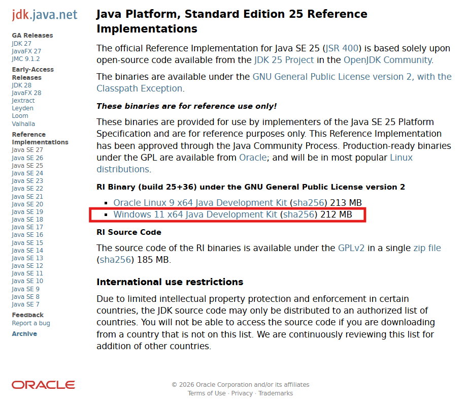
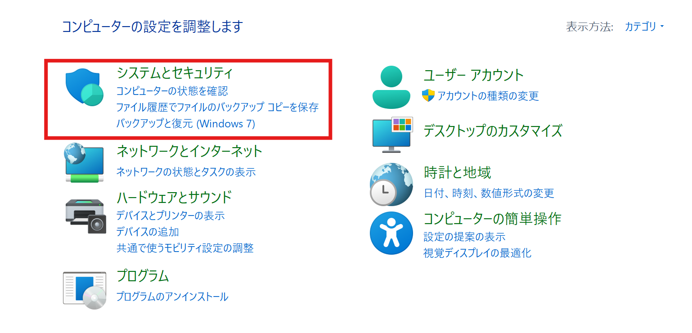
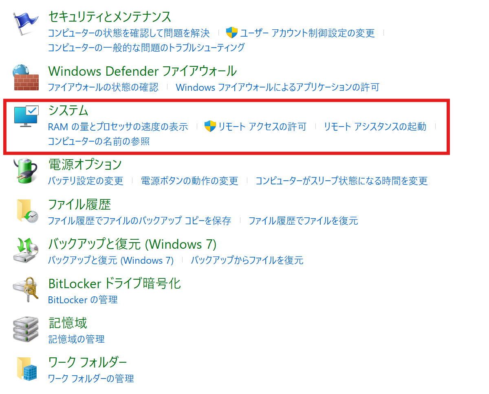
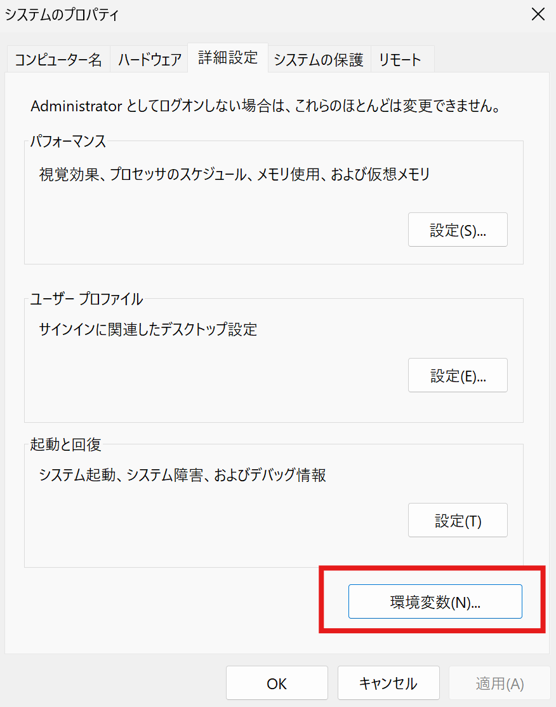
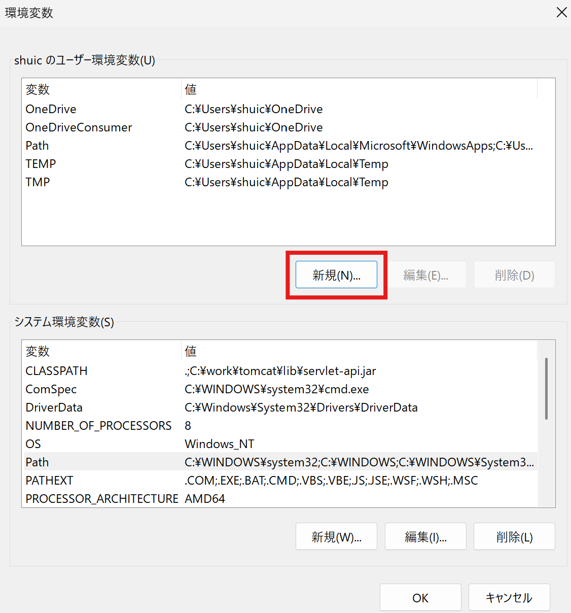
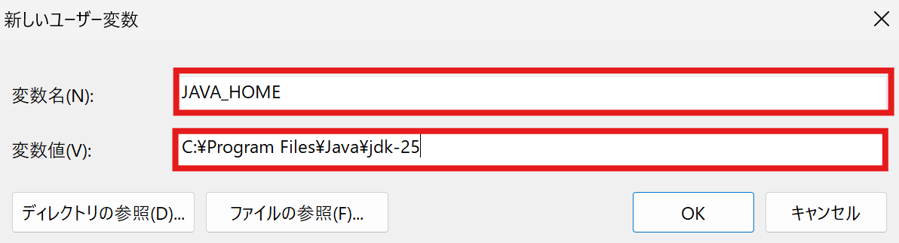

# 環境構築
## 1. JDK（Java Development Kit）のインストール
1. [JDK-25](https://jdk.java.net/java-se-ri/25)をクリック
2. Windows 11 x64 Java Development Kitをクリック
   
3. ファイルを展開する
4. `C:\Program Files`直下に`Java`フォルダを作ってそこに展開したファイル一式を置く。実際にはどこでもいいがそろえる。
5. コントロールパネル→システムとセキュリティ押下
    
6. システム押下
    
7. システムの詳細設定押下
    
8. 環境変数（N）押下
    
9. ユーザー環境変数の追加
    
10. 変数名を「`JAVA_HOME`」にし、変数値にJDK(Java Development Kit) のインストールにてJDKを保存した場所を記述。（絶対パス）
    
11. 