# 要件定義書<**multi-management-system**(仮称)>

## 目的
宮崎マルチメディア専門学校における生徒情報の管理業務を効率化し、教育および学生支援の質を向上させるため、統合型の「生徒情報管理システム」を開発する。
### 背景と課題
現状、教職員が手作業や分散した個別システム（Excel等）で管理している以下の情報は、業務の属人化や情報のサイロ化を招いている。
- 出欠状況
- 履修登録・単位状況
- 成績評価
- 就職活動の進捗状況
### 達成目標
1. 情報の完全一元管理: 教職員が上記すべての生徒情報を一ヶ所で集約・管理し、必要なデータを自動で即時取得できるようにする。
2. 学生の利便性向上: 生徒自身が自分の情報（出欠・成績・就活状況など）をいつでも閲覧できる環境を提供し、円滑な学校生活をサポートする。

## 機能・業務要件

### 出席管理

#### 機能要件

学校における出欠状況の管理・通知業務を正確かつ効率的に行う。主な機能は以下のとおり。

| 機能 | 概要 |
|---|---|
| 出席情報の自動継承 | 朝のHRまたは前時限の出欠情報を引き継ぎ、教員は差分のみを登録 |
| 座席表による出席確認 | 実際の座席配置を再現し、出欠状況を視覚的に確認・変更 |
| 時限単位の出欠管理 | 生徒・時限ごとに出欠を独立して記録し、過去の情報を保持 |
| 進級判定の支援 | 科目別の出席状況・出席率を集計し、進級規定への抵触リスクを可視化 |
| 連絡業務の効率化 | 家庭向け出席情報PDFの出力 |
| 出席記録の確認・訂正 | 登録済みの出欠情報を確認・訂正 |
| 出席記録の閲覧 | 教員・生徒が出席記録を閲覧 |

##### 出欠区分

出欠情報は生徒・時限ごとに管理し、確定時に以下の5区分に分類する。

| 出欠区分 | 定義 | 判定方法 |
|---|---|---|
| 出席 | 授業開始から20分未満に出席し、早退せず最後まで受講 | 教員による確認・登録 |
| 遅刻 | 授業開始から20分以上経過して出席 | 出席登録時刻に基づく自動判定 |
| 欠席 | 授業終了まで受講しなかった | 授業終了時の出席状況に基づく判定 |
| 早退 | 授業の途中で下校した | 教員による早退登録 |
| 公欠 | 学校が認める所定の事由により授業を受講しなかった | 担任による登録 |

##### 出席情報の継承

各授業の開始時には、朝のHRまたは前時限の確定情報を引き継ぎ、出欠候補として表示する。

| 前時限の確定情報 | 次時限の初期状態 |
|---|---|
| 出席 | 出席候補 |
| 欠席 | 欠席候補 |
| 遅刻 | 出席候補 |
| 早退 | 欠席候補 |
| 公欠 | 公欠候補 |

継承元の情報が存在しない場合は、未登録または事前連絡に基づく候補として表示する。出欠候補は当該時限の出席確認に使用する初期状態であり、**前時限の確定情報を変更するものではない**。

##### 出欠情報の登録・確定

出欠情報の登録は、以下の手順で行う。

1. **事前連絡の登録**
   - 担任が欠席・遅刻・早退・公欠などの事前連絡を登録する。
2. **朝のHRでの出席確認**
   - 担任が座席表で出欠を確認・登録する。
   - 登録を忘れ未登録の場合は、そのまま未登録として、1限の担当教員に全員の出席を登録させる。
3. **各授業開始時の出席確認**
   - HRまたは前時限の確定情報から出欠候補を自動生成する。
   - 担当教員は実際の出席状況と照合し、異なる生徒のみ候補を変更する。
   - 継承情報がない生徒については、出席状況を確認して候補を設定する。
4. **授業中の出欠変更**
   - 途中入室・早退が発生した場合、担当教員が該当生徒の候補を変更する。
   - 途中入室については、画面に表示される授業開始からの経過時間と遅刻判定に従って登録する。
   - 変更のない生徒については、既存の候補を維持する。
5. **授業終了時の確定**
   - 担当教員が全生徒の出欠候補を最終確認する。
   - 保存ボタンを押すことで、当該時限の出欠情報を確定する。
   - 保存を複数回押した場合上書きされる
   - 確定情報を出席率・進級判定用の集計に反映し、さらに次時限の出欠候補の継承元とする。

##### 科目別出席時数の管理

| 機能 | 概要 |
|---|---|
| 年間日程の設定 | 授業日程・長期休みなどを設定し、計算材料にする |
| 規定時数の設定 | 科目ごとに進級に必要な出席時数を設定 |
| 出席時数の集計 | 確定した出欠情報から科目・生徒別の累積出席時数を算出 |
| 特殊日程の換算 | 休校・公欠は本来予定されていた科目の時数として算入 |
| 試験・行事の処理 | 試験は授業時数に含めず、学校行事は「社会常識」の時数として算入 |
| 自動再計算 | 出欠情報の確定・訂正時に集計値と判定結果を更新 |

##### 出席ペースの算出

年間総授業時数が固定されないため、**規定時数と年度内の経過期間に基づいて出席ペースを評価する**。

| 指標 | 計算式 |
|---|---|
| 規定時数達成率 | 累積出席時数 ÷ 規定時数 × 100 |
| 必要出席ペース | 規定時数 ÷ 年間授業対象週数 |
| 実績出席ペース | 累積出席時数 ÷ 経過授業対象週数 |
| 出席ペース達成率 | 実績出席ペース ÷ 必要出席ペース × 100 |
| 年度末予測時数 | 実績出席ペース × 年間授業対象週数 |
| 予測過不足時数 | 年度末予測時数 − 規定時数 |

- 授業対象週数は科目の対象期間に基づいて算出する
- 年度末予測は現在までの実績を基準とし、将来の時間割変更によって変動する

#### 進級リスク判定

出席ペース達成率・年度末予測時数・欠席可能時数に基づき、科目ごとの進級リスクを4段階で判定する。

| 判定 | 判定基準 |
|---|---|
| 正常 | 規定時数を達成済み、または出席ペース達成率が100%以上 |
| 注意 | 出席ペース達成率が90%以上100%未満 |
| 警告 | 出席ペース達成率が90%未満 |
| 規定抵触 | 規定時数に到達できないことが確定 |

#### 判定結果の表示

| 機能 | 概要 |
|---|---|
| 生徒別表示 | 生徒ごとの総合判定と科目別判定を一覧表示 |
| 科目別表示 | 科目ごとの規定時数・出席時数・達成率・予測時数を表示 |
| リスク対象者一覧 | 一科目でも注意・警告・規定抵触の生徒を抽出 |
| 判定根拠の表示 | 判定に使用した数値を表示 |
| 自動更新 | 出欠情報の変更に連動して判定結果を更新 |

##### PDF帳票出力

家庭への通知および校内業務で使用する出席情報を、PDF形式で以下の項目を生徒単位かつ1日単位で出力可能。

- 学校名
- 生徒氏名・学籍番号・クラス
- 対象期間
- 科目別出席状況[規定到達・順調・警告・未達確定]
- 期間内の科目別出欠集計[時間]
- 出席率
- 必要に応じた学校からの連絡事項
- 出力日

#### 業務フロー
##### 出席管理業務

```mermaid
%%{init: {
    "theme": "base",
    "themeVariables": {
        "darkMode": true,
        "background": "#1A1B26",
        "primaryColor": "#24283B",
        "primaryTextColor": "#C0CAF5",
        "primaryBorderColor": "#414868",
        "lineColor": "#7C86B5",
        "secondaryColor": "#292E42",
        "tertiaryColor": "#1F2335",
        "fontFamily": "Noto Sans JP, Yu Gothic, sans-serif",
        "fontSize": "14px",
        "edgeLabelBackground": "#1A1B26",
        "clusterBkg": "#1F2335",
        "clusterBorder": "#414868"
    },
    "flowchart": {
        "curve": "basis",
        "nodeSpacing": 45,
        "rankSpacing": 55,
        "padding": 16,
        "htmlLabels": true
    }
}}%%

flowchart TD
    START(["当日の出席管理開始"])

    subgraph HR["① 事前連絡・朝のHR"]
        A{"事前連絡があるか"}
        B["担任が事前連絡を登録"]
        C["朝のHR開始"]
        E{"出欠確認をしたか"}
        F["HRの出欠情報を登録"]
        G["未登録のまま1限へ"]

        A -->|あり| B --> C
        A -->|なし| C
        C --> E
        E -->|はい| F
        E -->|いいえ| G
    end

    subgraph LESSON["② 各授業の出席管理"]
        H["授業開始"]
        I["担当教員が出席確認画面を開く"]
        J["HRまたは前時限の確定情報を継承"]
        K["座席表で実際の出席状況を確認"]
        L{"出欠候補の変更が必要か"}
        M["該当生徒の候補を変更"]
        N{"授業終了か"}
        O["出欠候補を最終確認"]
        P["保存して当該時限の出欠を確定"]

        H --> I --> J --> K --> L
        L -->|はい| M --> N
        L -->|いいえ| N
        N -->|いいえ| L
        N -->|はい| O --> P
    end

    subgraph SUMMARY["③ 出席状況の集計・計算"]
        Q["科目別出席時数を集計"]
        Q1["各指標を算出"]

        Q --> Q1
    end

    subgraph JUDGMENT["④ 進級リスク判定"]
        BA{"規定到達不可能が確定"}
        BB{"規定時数を達成済みか"}
        BC{"出席ペース達成率が90%未満か"}
        BD{"出席ペース達成率が100%未満か"}

        NORMAL["正常"]
        CAUTION["注意"]
        WARNING["警告"]
        VIOLATION["規定抵触"]

        BA -->|はい| VIOLATION
        BA -->|いいえ| BB
        BB -->|はい| NORMAL
        BB -->|いいえ| BC
        BC -->|はい| WARNING
        BC -->|いいえ| BD
        BD -->|はい| CAUTION
        BD -->|いいえ| NORMAL
    end

    CA["科目別判定・判定根拠を更新"]

    R{"次の授業があるか"}
    S["確定情報から出欠候補を生成"]

    R -->|あり| S

    T["当日の出席確認終了"]
    X{"出席情報の訂正が必要か"}
    Y["出席情報を訂正・確定"]
    Z["出席時数・各指標を再計算"]
    U{"無連絡欠席者がいるか"}
    V["担任が確認メールを送信"]
    W["出席状況を確認"]
    W2["必要に応じてPDF出力"]
    END(["終了"])

    T --> X
    X -->|あり| Y --> Z --> U
    X -->|なし| U
    U -->|いる| V --> W
    U -->|いない| W
    W --> W2 --> END

    START --> A
    F --> H
    G --> H

    P --> Q
    Q1 --> BA

    NORMAL --> CA
    CAUTION --> CA
    WARNING --> CA
    VIOLATION --> CA

    CA --> R
    S --> H
    R -->|なし| T

    %% 工程の背景
    style HR fill:#1D2940,stroke:#7AA2F7,stroke-width:2px,color:#C0CAF5
    style LESSON fill:#193237,stroke:#73DACA,stroke-width:2px,color:#C0CAF5
    style SUMMARY fill:#292440,stroke:#BB9AF7,stroke-width:2px,color:#C0CAF5
    style JUDGMENT fill:#292E42,stroke:#7C86B5,stroke-width:2px,color:#C0CAF5

    %% ノード共通スタイル
    classDef terminal fill:#344B79,stroke:#7AA2F7,stroke-width:2px,color:#FFFFFF,font-weight:bold
    classDef process fill:#24283B,stroke:#565F89,stroke-width:1.5px,color:#C0CAF5
    classDef input fill:#243C60,stroke:#7AA2F7,stroke-width:1.8px,color:#DCE7FF
    classDef decision fill:#403523,stroke:#E0AF68,stroke-width:2px,color:#FFE3B0
    classDef automated fill:#332B4C,stroke:#BB9AF7,stroke-width:1.8px,color:#E2D5FF
    classDef confirmed fill:#1D4948,stroke:#73DACA,stroke-width:2px,color:#D1FFF4,font-weight:bold
    classDef output fill:#203F56,stroke:#7DCFFF,stroke-width:1.8px,color:#D9F3FF

    %% 進級リスク
    classDef normal fill:#1D4435,stroke:#9ECE6A,stroke-width:2px,color:#CBF5A6,font-weight:bold
    classDef caution fill:#4A4024,stroke:#E0AF68,stroke-width:2px,color:#FFE0A3,font-weight:bold
    classDef warning fill:#4B3027,stroke:#FF9E64,stroke-width:2px,color:#FFD0AE,font-weight:bold
    classDef violation fill:#502C38,stroke:#F7768E,stroke-width:2px,color:#FFD1DA,font-weight:bold

    %% スタイル適用
    class START,END terminal
    class A,E,L,N,BA,BB,BC,BD,R,X,U decision
    class B,F,M,O,Y,V input
    class C,G,H,I,K,T,W,W2 process
    class J,Q,Q1,S,Z automated
    class P confirmed
    class CA output

    class NORMAL normal
    class CAUTION caution
    class WARNING warning
    class VIOLATION violation

    %% 接続線
    linkStyle default stroke:#7C86B5,stroke-width:1.8px
```

