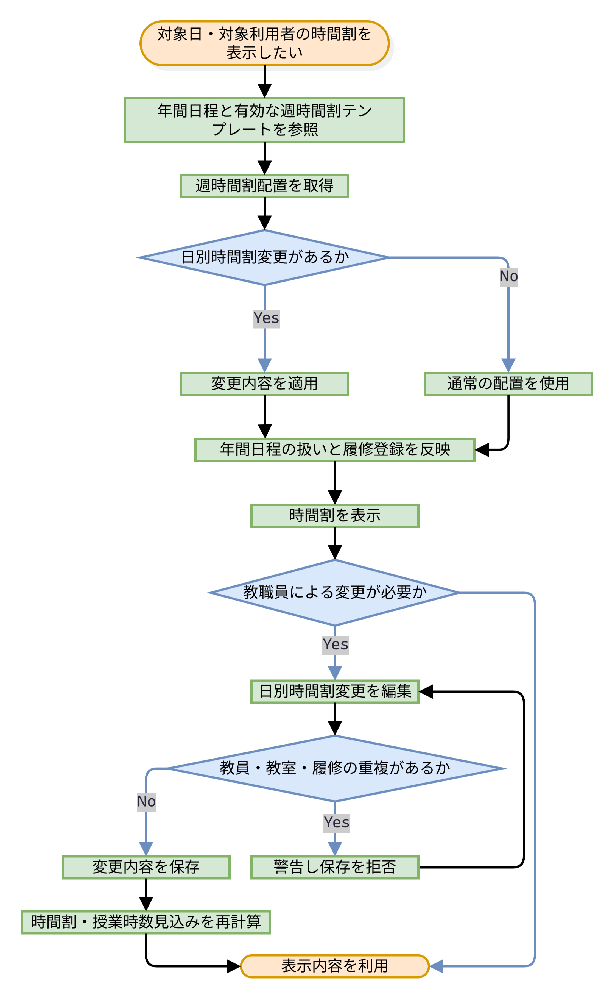
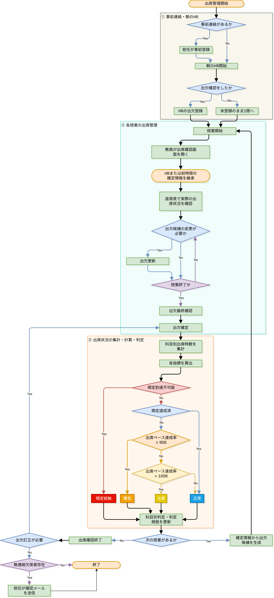

# 要件定義書 **multi-management-system**<仮称>

## 目的

宮崎マルチメディア専門学校における生徒情報の管理業務を効率化し、教育および学生支援の質を向上させるため、統合型の「生徒情報管理システム」を開発する。

### 背景と課題

現状、教職員が手作業や分散した個別システム（Excel等）で管理している以下の情報は、業務の属人化や情報の分散を招いている。

- 出欠状況・出席時数
- 履修登録・科目別規定時数・進級状況
- 学期別評価点・年間成績
- 就職活動・選考履歴
- 取得資格
- 学科・コース・クラス・時間割・年間日程などの教育運営情報

### 達成目標

1. **情報の一元管理**：教職員が必要な生徒情報を一か所で登録・更新・参照できるようにする。
2. **教員の入力負担軽減**：基本時間割の自動適用、出欠候補の自動継承、座席表からの差分入力によって操作を減らす。
3. **正確性の向上**：時限・科目・年度を区別し、履修や教員・教室の重複を検査する。
4. **学生の利便性向上**：生徒が自身の時間割・出欠・成績・資格・就職活動状況を確認できるようにする。
5. **進級支援**：出席時数・規定時数・出席ペースから指標を計算し、教員の注意喚起・判断を支援する。

### 技術・画面仕様

| 項目 | 方針 |
|---|---|
| 開発技術 | HTML、Tailwind CSS（DaisyUI）、JavaScript、Java[JSK25]（JSP、 Servlet）、HTMX、MySQL（JDBC）、Apache Tomcat |
| 開発ツール | VScode、Maven、Git/GitHub、draw.io(フロー図、ER図等作成)、Figma（画面デザイン作成）、chatGPT、Gemini
| 画面構成 | Hypermedia-Driven Application (HDA) ：HTMLをベースにSPA的なUXを実現（HTMXを利用）|
#### 技術選定理由
本システムでは、JSP/Servletによる堅牢なMPA（Multi Page Application）の構造をベースにしつつ、SPA（Single Page Application）のようなシームレスな操作性を実現するため、HTMXを用いたHypermedia-Driven Application（HDA / ハイブリッドMPA/SPA）のアーキテクチャを採用した。一般的にSPA開発では、REST APIサーバー（Spring BootやLaravel等）とフロントエンドフレームワーク（ReactやVue等）の組み合わせがデファクトスタンダードとされる。しかし今回はチーム開発であり、限られた開発期間の中で「メンバーの学習負荷を低く抑えること」と「システムの品質を担保すること」の両立が重要であった。そこで、JSON APIの構築や複雑なフロントエンドのビルド環境を導入するのではなく、サーバー側（Servlet/JSP）から直接HTMLの断片（Fragment）を返却し、ページの一部を動的に書き換える「HTMX」に着目した。HTMLベースで直感的に実装できるため学習コストが非常に低く、MPAのシンプルな構成を維持したままSPAのような快適なUXを実現できる点から、本プロジェクトに最適な技術選定となった。

## 機能・業務要件

### 利用者・権限管理

#### 登場人物と役割

| 利用者 | 主な役割 |
|---|---|
| 生徒 | 自身の履修科目・時間割・出欠・成績・資格・就職活動情報の閲覧、就職活動情報の登録・更新 |
| 担任（HR担当） | クラス・生徒情報の確認、朝HRの出欠登録、事前の出欠入力、必要に応じた連絡業務 |
| 教科担当教員 | 担当授業の出席確認・保存、担当科目の学期別評価点の登録・編集 |
| 学校管理者（任意） | 学科・コース・教育課程・クラス・年度・学期・科目・時間割・年間日程等の管理 |
- 時間割の登録・変更は全教職員が行える。
- 生徒は原則として自身の個人情報・記録のみを閲覧する。

### ログイン機能

生徒および教職員がシステムに安全にアクセスし、それぞれの権限に応じた画面へ遷移できる機能を提供する。

#### 認証情報（ID／パスワード）仕様

- **ログインID**：学校配布のメールアドレス
  - 生徒：例 `mmc11111@student.multi-m.ac.jp`
  - 教職員：例 `mmc11111@teacher.multi-m.ac.jp`
- **初期パスワード**：システム管理側がランダムに発行する一次パスワード
  - **パスワード変更時の規則**：12文字以上で、英大文字・英小文字・数字・記号の4種類を必須とする
  - **アカウントの対応**：生徒・教職員はそれぞれ必ず1アカウントのみを持ち、1アカウントは生徒か教職員のいずれか一方に対応する

#### ログイン処理・遷移フロー

##### ログイン画面

- メールアドレスとパスワードの入力フォームを表示する。
- 「ログイン」ボタンと「パスワードを忘れた方はこちら」のリンクを設ける。

##### 認証成功時

- 生徒は生徒用ダッシュボードへ遷移する。
- 教職員は教職員用ダッシュボードへ遷移する。
- 生徒が教職員専用URLへアクセスするなど、権限外のアクセスは `403 Forbidden` として拒否する。
- 生徒は権限のない他者の個人情報を閲覧・変更できないようにする。

##### 認証失敗時

- ログイン画面へ戻し、共通のエラーメッセージを表示する。
- メールアドレスの存在有無とパスワード誤りを区別して通知しない。（セキュリティ対策）

#### セッション管理

- 無操作状態が20分間続いた場合はセッションを失効させ、再ログインを必要とする。
- ログアウト時にはサーバー側の認証セッションを無効化し、認証に用いるCookieを失効させる。

#### パスワード変更・再設定

- ログイン済みユーザーは、現在のパスワード・新しいパスワード・新しいパスワード（確認用）を入力して変更する。
  - 現在のパスワードと入力規則を検証する。
- ログイン画面の「パスワードを忘れた方はこちら」では、担任に連絡し、教員の管理画面から再設定してもらう旨をモーダルで案内する。

### 学籍・教育課程・クラス管理

教育課程（年度・学期・学科・コース）・クラス・生徒の所属関係を管理し、進級・年度更新・クラス変更後も過去の所属情報を確認できるようにする。

#### 基本情報の管理

| 機能 | 概要 |
|---|---|
| 学科管理 | 学科の登録・編集・一覧表示 |
| コース管理 | 学科に所属するコースの登録・編集 |
| 年度管理 | 年度ごとの教育課程・時間割・学期・年間日程を区別 |
| 学期管理 | 1年度を学期を管理 |
| 教育課程管理 | 特定の年度・コース・学年に対応する科目構成を管理 |
| クラス管理 | 教育課程に対応するクラスを登録・管理 |
| クラス所属履歴 | 生徒の年度ごとの所属、進級・転コースなどの変更履歴を保持 |
| 担任割当 | クラスに対する担任の割当と履歴を保持 |
| 生徒・教職員情報 | 各利用者の基本情報を管理 |

#### 管理上の規則

- 教育課程は**年度・学期・学科・コース・学年の組合せに対応する教育内容**を表す。
- 規定時数や科目の配置は、年度の異なる教育課程間で独立させ、過年度の条件を保持する。
- 生徒のクラス所属は上書きせず、クラス所属履歴に保持する。
- 同じ時点で、生徒が所属する現在のクラスは1つとする。
- 1クラスには当該時点で担任が1人いるものとし、担任交代の履歴を保存する。
- 教科担当のみの教職員が存在してもよい。（外部講師など）

### 履修科目管理

必修科目と選択科目を、生徒・教育課程ごとに管理する。教育課程による共通の科目構成を基準とし、選択科目を生徒単位で登録できるようにする。

#### 機能要件

| 機能 | 概要 |
|---|---|
| 科目マスタ管理 | 科目名などを管理 |
| 教育課程別科目管理 | 年度・コース・学年ごとに科目を配置し、必修・選択区分と規定時数を設定 |
| 必修科目の履修 | 対象教育課程の必修科目を生徒の履修対象として設定 |
| 選択科目の履修 | 対象の生徒に対して選択科目を登録・変更 |
| 履修一覧 | 教員・生徒が対象生徒の履修科目を確認 |
| 時間割との連動 | 履修科目に対応する授業だけを生徒の時間割に表示、教職員には全コースの時間割および、自身が担当の授業の時間割を表示 |

### 時間割管理

#### 履修科目・基本情報の管理

学科・コース・学年および生徒の履修登録に応じて、時間割を作成・表示する。時間割の設定と変更は教職員画面で行う。

| 機能 | 概要 |
|---|---|
| 年間日程の登録 | 学校全体の授業日・休日・休校・試験・学校行事・長期休暇などを一括登録・編集 |
| 教室管理 | 時間割に割り当てる教室を登録・編集 |
| 科目・担当教員の設定 | 週時間割配置に科目、担当教員（複数可）、教室を設定 |
| 履修科目の反映 | 生徒の履修登録を参照し、生徒ごとの時間割を表示 |
| 教員用時間割 | 教員本人の担当授業を日付・時限順に表示し、対象授業の出席管理へ遷移 |
| 生徒用時間割 | 生徒本人の対象授業のみを表示 |
| 表示切替 | 日・週・月単位の表示に対応 |

#### 週時間割テンプレート・週時間割配置

時間割は**週時間割テンプレートを通常日の基準**として使用し、変更が必要な日・時限だけ個別に編集する。テンプレートのとおりに授業を行う場合、日ごとの登録操作は不要とする。

| 機能 | 概要 |
|---|---|
| 週時間割テンプレート | 教育課程ごとに通常の曜日・時限構成を登録・管理 |
| 週時間割配置 | テンプレート内の曜日・時限・教育課程別科目・担当教員・教室を配置 |
| 複数テンプレート | 期間によって基本時間割が変わる場合に備え、同一教育課程に複数のテンプレートを設定可能 |
| 自動反映 | 対象日の曜日・時限からテンプレートを参照し、通常の授業を表示 |
| 選択科目 | 同じクラスでも履修科目に応じた時間割を表示 |

- 同じ時限に異なる選択科目の配置が並行して存在することは、履修者・教員・教室の重複がなければ許容する。

#### 日別時間割変更

特定の日付・時限だけ、週時間割テンプレートから導かれる授業を変更する。基本テンプレートそのものは変更しない。

| 機能 | 概要 |
|---|---|
| 特定日の科目振替 | 当該日時の授業を、別の科目の授業に変更 |
| 空き時限への追加 | 授業のない時限に授業を追加する場合にも対応 |
| 教室の扱い | 教室だけの変更は行わず、当該授業の設定上の教室を用いる |
| 保存後の反映 | 教員・生徒の時間割表示と授業時数見込みに反映 |

**個別の担当教員変更・教室変更は行わない。**

- 担当教員が授業を実施できない場合は、その教員を変更するのではなく、別の科目の授業に振り替える。
- その際、振替先の科目に対応する既存の週時間割配置から担当教員を取得する。学校行事など授業以外に振り替える場合は個別に登録できるようにする
- 日別時間割変更は、変更対象の実施日・時限を識別できるものとする。
- 試験など、科目の通常授業として扱わない個別の予定は、日別時間割変更で扱う。

#### 年間日程・特殊日程

年間日程は**原則として学校全体で共通**とする。学科・コース・学年などで個別に異なる授業がある場合は、対象の「日別時間割変更」で手動調整する。

| 日程区分 | 授業時数の扱い |
|---|---|
| 通常授業日 | 対象日に配置された実授業の時間を科目別に算入 |
| 休校 | 本来予定されていた科目の時数として算入 |
| 公欠 | 本来予定されていた科目の時数として算入 |
| 試験 | 授業時数に含めない |
| 学校行事 | 「社会常識」の時数として算入 |
| 休日・長期休暇 | 原則として通常授業を設定しない |

- 休校・公欠の換算のため、**元の週時間割配置を消去しない**。
- 同一時間帯に特殊日程と通常授業の両方を二重計上しない。
- 学校行事を「社会常識」に算入する際は、対象教育課程にその科目が設定されていることを前提とする。
- 年間日程は期間指定・一括登録を可能にする。

#### 授業実施枠

**授業実施枠**は、特定の日付・時限における授業（またはHR等の出席確認対象）を識別する。

- 通常授業は週時間割配置を基に決定し、日別時間割変更がある場合は変更内容を反映する。
- 出席記録は授業実施枠に対応付ける。

#### 時間割登録・変更時の制約

| 機能 | 概要 |
|---|---|
| 教員の重複防止 | 同じ日時に同一教員を重複して割り当てない |
| 教室の重複防止 | 同じ日時に同一教室を重複して割り当てない |
| 履修の重複防止 | 同一生徒が同時刻に履修対象の複数授業を持たないよう検査 |
| 保存時検証 | 重複がある場合は警告を表示し、保存を拒否して修正させる |

#### 授業時数の管理・達成予測

科目ごとの**授業提供側の時数**を時間割と年間日程から集計する。

| 指標 | 算出・表示内容 |
|---|---|
| 実施済み授業時数 | 当該科目について実施された授業時間を集計 |
| 年度内の授業時数見込み | 登録済みの週時間割・日別変更・年間日程から年度末の授業提供時数を推計 |
| 規定時数との比較 | 教育課程別科目の規定時数に対して見込み時数の過不足を表示 |
| 時間割登録時の警告 | 規定時数に到達しない恐れや、不足が確定した場合に不足時数を提示 |

- 授業時数は50分×出席コマ数に基づいて計算する。
- 時間割の追加・変更を反映して表示する指標を再計算する。
- 将来の授業予定が確定していない場合、予測値であることを明示する。
- 科目別規定時数は「教育課程別科目」に保存する。

#### 時間割管理業務フロー

<div style="page-break-before: always"></div>

### 出席管理

#### 機能要件

生徒・授業実施枠ごとに出欠状況を正確に記録し、座席表からの確認や前時限情報の継承によって入力負担を軽減する。

| 機能 | 概要 |
|---|---|
| 出席情報の自動継承 | 朝HRまたは前時限の**DB保存済み情報**から、フロントエンドで当該時限の出欠候補を生成 |
| 座席表による出席確認 | クラスの座席配置上で、生徒ごとの出欠を確認・変更 |
| 時限単位の出欠管理 | 生徒・授業実施枠ごとに独立して出欠を保持 |
| 事前入力 | 担任が未来の対象時限の出欠を**既存の出席記録に直接保存** |
| 出席記録の閲覧 | 教職員・生徒が権限に応じて履歴を閲覧 |
| 進級判定の支援 | 出席時数・規定時数・出席ペースから、リスク指標を計算して表示 |
| 連絡業務 | 家庭向けの出席情報PDFを出力 |


#### 出欠区分

| 出欠区分 | 定義・扱い | 判定方法 |
|---|---|---|
| 出席 | 開始から20分未満の出席で、途中退室なく受講 | 教員が確認・登録 |
| 遅刻 | 開始から20分以上経過して参加。この場合受講時間は0とする（実質欠席） | 対象授業の開始時刻と出席登録時刻に基づいて判定 |
| 欠席 | 当該授業を受講しなかった | 教員が確認・登録 |
| 早退 | 授業途中に退室・下校 | 教員が登録 |
| 公欠 | 学校が認める事由で授業を受講しなかった | 担任等が登録 |

#### 出席情報の継承

直近のHRまたは前時限の保存済み出席記録を取得し、**出欠の初期候補を生成する**。そうすることで、教員は前時限との差分だけ登録し、入力を減らす。

| 前時限の保存済み出欠区分 | 次時限の初期表示 |
|---|---|
| 出席 | 出席候補 |
| 欠席 | 欠席候補 |
| 遅刻 | 出席候補 |
| 早退 | 欠席候補 |
| 公欠 | 公欠候補 |

- 候補は**DBに保存しない**。教員が画面上で候補を変更するだけではDBも変更しない。
- 生徒に対して**当該時限の出席記録が既に存在する場合は、それを優先して表示**する。（事前登録された生徒の扱い）
- 継承元の記録が存在しない場合は未登録として扱い、その時限の担当教員が確認して入力する。

#### 出席情報の事前登録・保存・訂正

**DBに保存されている出席記録を正式な情報として扱い、「候補／確定」という状態属性は設けない。**

1. **事前登録**：担任が翌日等の対象時限に対して、欠席・遅刻・早退・公欠等の出席記録を先に保存できる。
2. **朝HR**：担任が出席確認を行い、保存する。未登録（出欠確認を忘れた）のまま1限を迎える場合、1限の担当教員が実際の出欠をすべて入力することになる。
3. **授業開始時**：担当教員が出席確認画面を開き、当該時限の保存済み記録があれば表示し、それ以外は前時限等から候補を生成する。
4. **授業中**：途中入室・早退などに応じて教員が画面上の区分を変更する。
5. **保存**：教員が保存すると当該時限の出席記録をDBに保存される
6. **訂正**：保存済みの出席記録を再編集した場合は同じ記録を更新する。出欠訂正したという履歴は管理しない。
7. **次時限への反映**：保存された出席記録は、次時限の初期候補の生成に利用できる。

- 事前入力で終日欠席などを登録する場合は、その日の対象授業実施枠へ一括登録する処理で対応する。
- 事前入力後に時間割が変わる場合のレコードの扱いは詳細設計で定める。
- 未来の授業に事前入力された記録を、実施済みの出席時数として先取り計上しない。
<div style="page-break-before: always"></div>

#### 出席管理業務フロー

<div style="page-break-before: always"></div>

### 座席表・座席割当管理

出席登録画面のため、クラスごとの座席配置と生徒の割当を管理する。

#### 座席表・座席の管理

| エンティティ | 役割 |
|---|---|
| 座席表 | クラスに属する座席レイアウト全体 |
| 座席 | 座席表に属する個々の席 |
| 座席割当履歴 | 生徒と座席の対応関係・有効期間(席替えのため) |

- 座席の位置は**行番号・列番号**の単純な行列で表現する。
- 設定画面では行数・列数の入力によって座席を自動生成する。
- **実際の通路・机の間隔・教室固有の不規則な物理配置は再現しない。（フロント側で再現する可能性はあり）**
- 座席表の行・列の組合せは重複しないようにする。
- 生徒が割り当てられていない座席は空席として表示する。


#### 席替えと履歴

- 座席を移動した場合は、現在の割当履歴を終了し、新しい割当履歴を作成する。
- 履歴には有効開始日時・有効終了日時を管理する。
- 同一時点で1つの座席に複数生徒が割り当てられないようにする。
- 同一時点で1人の生徒に同じクラス内の複数座席を割り当てない。
- 過去の座席配置が必要な場合は、有効期間から再現できるようにする。

### 科目別出席時数・進級判定支援

科目ごとの規定時数と出席実績を比較し、進級に対する状況を教員・生徒に示す。**進級の最終決定を自動的に確定する機能ではなく、教員の判断を支援する画面表示機能**とする。

#### 科目別出席時数の管理

| 機能 | 概要 |
|---|---|
| 規定時数の参照 | 教育課程別科目から科目ごとの規定時数を取得 |
| 実時間に基づく集計 | 各授業の予定・実施時間に基づいて科目別時数を算出 |
| 生徒別集計 | 履修登録・出席記録に基づいて生徒別の出席・欠席状況を算出 |
| 特殊日程の換算 | 休校・公欠は本来の予定科目、試験は授業なし扱い、学校行事は社会常識で扱う |
| 自動再計算 | 出席記録・時間割・年間日程の保存や訂正後、次回表示する値を再計算 |


#### 出席ペースの算出

年度内に実施する科目の総授業時数が事前に固定されないため、規定時数と授業対象期間に基づいて出席ペースを評価する。

| 指標 | 計算式 |
|---|---|
| 規定時数達成率 | 累積認定出席時数 ÷ 規定時数 × 100 |
| 必要出席ペース | 規定時数 ÷ 年間授業対象週数 |
| 実績出席ペース | 累積認定出席時数 ÷ 経過授業対象週数 |
| 出席ペース達成率 | 実績出席ペース ÷ 必要出席ペース × 100 |
| 年度末予測時数 | 実績出席ペース × 年間授業対象週数 |
| 予測過不足時数 | 年度末予測時数 − 規定時数 |

- 授業対象週数は該当科目の対象期間を基準に算出する。
- 年度末予測は予測値であり、将来の時間割変更・出席状況によって変化する。
- 将来の時間割が確定していない場合、到達不能と断定しない。

#### 進級リスク判定

科目ごとの出席ペース・年度末予測・規定時数との差を基に、次の4段階の状態を判定する。

| 判定 | 判定基準 |
|---|---|
| 正常 | 規定時数を達成済み、または出席ペース達成率100%以上 |
| 注意 | 出席ペース達成率90%以上100%未満 |
| 警告 | 出席ペース達成率90%未満 |
| 規定抵触 | 残りの確定した対象授業で最大限出席しても規定時数に到達できないことが確実な場合 |

#### 判定結果の表示

| 機能 | 概要 |
|---|---|
| 生徒別表示 | 生徒ごとの総合的な注意状態・科目別の状態を表示 |
| 科目別表示 | 規定時数・認定出席時数・達成率・予測時数・不足見込みを表示 |
| リスク対象者一覧 | 1科目でも注意・警告・規定抵触となる生徒を抽出 |
| 判定根拠の表示 | 教員が理由を確認できるよう計算値を提示 |
| 動的更新 | 記録変更後に再取得・再計算した結果を表示 |

#### PDF帳票出力

家庭への通知および校内業務に使用する出席情報を、生徒単位・任意の対象期間でPDF出力できるようにする。

- 生徒氏名・学籍番号・学科：コース
- 対象期間
- 科目別出席状況（規定到達・順調・警告・不足確定等）
- 期間内の科目別出欠集計（時数）
- 出席率・達成率
- 必要に応じた学校からの連絡事項
- 出力日

### 成績評価

各学期の科目別評価点を管理し、**年間平均点に対して「優・良・可・不可」の評価を行う**。

#### 成績情報の管理

| 機能 | 概要 |
|---|---|
| 学期別評価点の保持 | 生徒・履修科目・学期ごとに評価点（0～100点）を保存 |
| 年間平均の算出 | 前期・後期の評価点から年間平均を計算 |
| 年間評価の算出 | 年間平均点から優・良・可・不可を判定 |
| 評価点の編集 | 担当教員が評価点を登録・更新 |
| 未入力の扱い | 未入力の学期は0点と区別し、必要な評価点が揃うまで年間評価を未確定として表示 |
| 統計情報 | 同一学科・コース等の対象集団について科目別評価平均点・偏差値・順位を算出・表示 |
| 一覧・絞り込み | 生徒、科目、学期、点数順などで絞り込み |
| 成績PDF出力 | 家庭向けの成績一覧等をPDFとして発行 |

**試験ごとの点数は管理しない。** 試験点数の専用表示も行わない。試験・平常点等をどのように合成して学期評価点を決定するかは、科目ごとの教員の採点運用に委ねる。あくまで最終評価点を記録する。**教員側から全評価項目も保持したいという要請があればこの限りでない。**

#### 学期別評価点と年間評価

年度は前期・後期の2学期とする。両方の学期の評価点が存在する場合、年間平均は次式による。

```text
年間平均点 = (前期評価点 + 後期評価点) / 2
```

| 年間平均点 | 評価記号 | 年間評価 |
|---|---|---|
| 80点以上100点以下 | A | 優 |
| 70点以上80点未満 | B | 良 |
| 60点以上70点未満 | C | 可 |
| 60点未満 | D | 不可 |

- **優・良・可・不可は学期ごとの評価点に直接付けず、年間平均に対して判定する。**
- 追試・再試等を経て評価点が確定するまで、未入力として管理できる。
- 年間平均の端数処理、単一学期だけ履修する科目の年間評価方法は未確定とする。

#### 成績表示・利用者別の機能

| 利用者 | 画面・機能 |
|---|---|
| 生徒 | 自身の過年度・当年度の学期別科目評価点、年間平均点・年間評価を閲覧 |
| 生徒 | 科目別平均点等を表示。年間評価が不可の場合は注意を表示 |
| 教員 | 担当科目の生徒別・学期別評価点を登録・編集 |
| 教員 | 学期別評価点・年間評価・科目別平均点・偏差値・順位を確認 |
| 教員 | 不可の生徒や評価区分別に絞り込み・色分け表示 |

### 就職活動管理

生徒自身が志望・受験企業ごとの選考状況・予定・結果を登録・更新し、教職員が進捗を閲覧・支援できるようにする。

#### 企業・勤務地・就職活動情報

| 機能 | 概要 |
|---|---|
| 企業管理 | 企業名等の企業情報を登録・管理 |
| 企業勤務地 | 企業が持つ事業所・勤務場所などの所在地情報を管理 |
| 企業別就活状況 | 生徒が企業ごとに志望・応募状況、現在の結果、メモ等を登録・更新 |
| 選考履歴 | 企業への応募ごとに説明会・選考段階・予定日・実施日・結果等を時系列で管理 |
| 進捗共有 | 生徒本人と権限を持つ教職員が企業別の進捗・結果を閲覧 |
| 複数企業への応募 | 1人の生徒が複数企業の就職活動を並行して管理 |

- 「企業勤務地」は、企業が実際に持つ所在地・拠点の情報を示すものである。
- 選考履歴は未来の選考予定も保持できるようにし、未定の日付は空欄(または未定)を許容する。
- 選考結果が未判明の状態も管理できる。

#### 就活ステータス・選考段階

| 区分 | 選択値 |
|---|---|
| 選考前・説明会 | 受験検討／会社説明会 |
| 書類・試験 | 書類選考／WEBテスト／筆記試験 |
| 面接 | 1次面接／2次面接／3次面接／4次面接／最終面接 |
| 結果 | 不合格／内定／内々定／辞退 |
| その他 | その他（生徒本人が内容を設定） |

- 選考段階ごとに日程や結果を登録・更新する。
- 進捗は企業別就活状況と関連する選考履歴から表示する。

#### 教職員向けの集計・連絡機能

| 機能 | 概要 |
|---|---|
| 絞り込み | 生徒、企業、選考段階、選考結果等から抽出 |
| エントリー数 | 生徒ごとのエントリー数を算出・並べ替え |
| 内定数 | 生徒ごとの内定数を算出・並べ替え |
| 注意喚起 | エントリー数・内定数が比較対象集団の中央値・平均値を下回る場合に警告表示 |
| 連絡メール | 説明会・面接日程・選考結果等を対象生徒へ個別・一括送信ができる |

- 内定数・エントリー数・注意表示は、保存済みの就職活動情報から計算する。

#### 履歴書・証明書関連

| 機能 | 現時点の扱い |
|---|---|
| 履歴書の自動出力 | 生徒情報等を用いて出力する機能を想定。出力形式（PDF／XLSX等）は未確定 |
| 成績証明書・卒業見込み証明書の申請 | 送付先会社や申請者情報などを自動でスニペットとしてメールを作成し担当の先生に自動送付 |


### 資格取得管理

生徒の取得資格を一元管理し、教員が登録・更新できるようにする。

#### 機能要件

| 機能 | 概要 |
|---|---|
| 資格取得記録 | 生徒が取得した資格・取得年月を保持 |
| 登録手順 | 生徒が教員に取得を報告し、**教員のみ**が登録・更新 |
| 閲覧 | 生徒本人と権限を持つ教員が取得資格を閲覧 |


