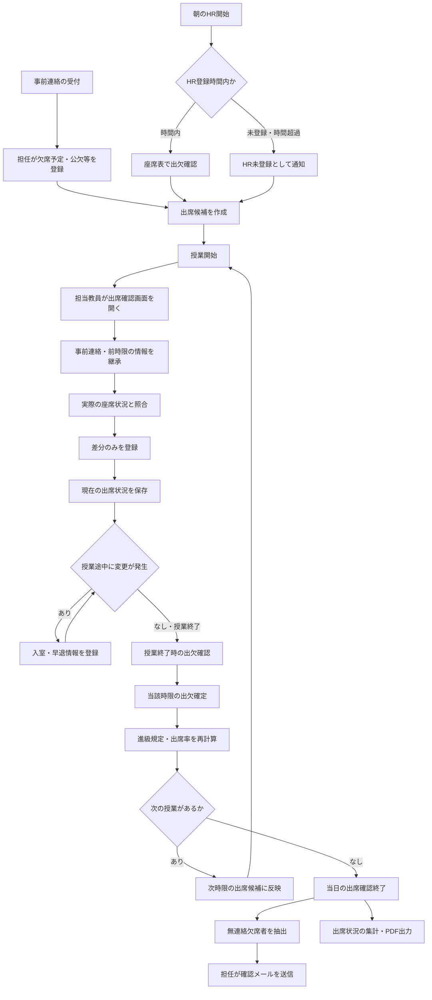

# 要件定義書<**multi-management-system**(仮称)>

## 目的
宮崎マルチメディア専門学校における生徒情報の管理業務を効率化し、教育および学生支援の質を向上させるため、統合型の「生徒情報管理システム」を開発する。
### 背景と課題
現状、教職員が手作業や分散した個別システム（Excel等）で管理している以下の情報は、業務の属人化や情報のサイロ化を招いている。
- 出欠状況
- 履修登録・単位状況
- 成績評価
- 就職活動の進捗状況
### 達成目標
1. 情報の完全一元管理: 教職員が上記すべての生徒情報を一ヶ所で集約・管理し、必要なデータを自動で即時取得できるようにする。
2. 学生の利便性向上: 生徒自身が自分の情報（出欠・成績・就活状況など）をいつでも閲覧できる環境を提供し、円滑な学校生活をサポートする。

## 業務要件
### 出席管理
学校における出席・遅刻・欠席の確認、および進級判定に関わる出欠状況の管理・通知業務を、システムによって正確かつ効率的に行う。出席管理の主な目的は以下。

- **入力負担の軽減**：出席状態を前コマ、HRから自動継承し、教員は原則として差分のみを入力
- **座席表による直感的な操作**：生徒の座席配置を再現し、視覚的に出席状態を確認・変更
- **時限単位の正確な管理**：各授業の出欠を独立して記録し、過去の出席情報を保持
- **出欠判定の自動化**：授業開始時刻と出席登録時刻から遅刻を判定
- **登録漏れの防止**：未確認・未確定の授業を検知して担当教員へ通知
- **進級判定の支援**：科目別の出席状況を集計し、進級規定への抵触リスクを可視化
- **連絡業務の効率化**：無連絡欠席者への確認メールを簡単に送信
- **記録の信頼性確保**：変更履歴を保持し、後から登録内容を確認・訂正可能にする

#### 登場人物と役割

| 登場人物 | 役割 |
|---|---|
| 担任（HR担当） | 朝の出席確認、事前連絡の登録、無連絡欠席者への確認連絡、担当クラスの出席状況管理 |
| 教科担当教員 | 担当授業の出席確認、前時限からの差分更新(遅刻・早退・欠席の登録) |
| 生徒 | HR・授業への出席、指定された座席への着席、欠席・遅刻・早退の事前連絡 |
| システム | 出席情報の継承、時間判定、出欠記録の保存、進級判定支援、通知、集計、PDF出力 |

#### 権限の基本方針

- 担任は担当クラスの出席状況を閲覧し、事前連絡およびHRの出席を登録できる
- 教科担当教員は自身の担当授業の出席状況を登録・変更できる
- 生徒は自身の出席状況を閲覧できるが、出欠記録を直接変更できない
#### 出欠区分

出欠状態は生徒ごと・時限ごとに管理し、以下の5区分に分類する。

| 状態 | 定義 | 判定方法 |
|---|---|---|
| 出席 | 授業開始から20分未満の時点で受講を開始し、早退せず受講した | 教員の確認・登録 |
| 遅刻 | 授業開始から20分以上経過して受講を開始した | 実際の登録時刻から自動判定 |
| 欠席 | 授業終了まで受講しなかった | 授業終了時の確認結果から判定 |
| 早退 | 授業の途中で下校した | 教員による早退登録 |
| 公欠 | 学校が認める所定の事由により受講しなかった | 担任による登録 |

※20分という判定基準は初期設定値とし、学校の規定に合わせて変更可能とする。
#### 出席管理方式

出席管理は、**「差分更新方式」と「時限ごとの出欠確定方式」を組み合わせて運用する。** 朝のHRまたは直前の授業で確認された情報を次の授業の出席候補として引き継ぎ、教員は実際の教室の状況との相違点を更新する。各授業の出席状態は独立して管理し、担当教員が確認を完了し、その時限の終了時点で出席情報を確定する。

#### 出席情報の継承ルール

- 原則として、前時限に出席していた生徒を次時限の出席候補として表示する
- 前時限に欠席していた生徒は欠席候補として表示する
- 登録された事前欠席予定・公欠情報を反映する
- 早退が登録された生徒は、以降の時限を欠席候補として表示する
- 授業開始前に登校した生徒や途中から登校した生徒は、実際の入室状況に応じて登録する

## 5. 出席登録の業務フロー

### 5.1 ① 事前連絡の登録

生徒から欠席・遅刻・早退・公欠などの連絡があった場合、担任は事前にその内容を登録する。

#### 登録内容

- 対象生徒
- 対象日
- 対象時限（終日・一部時限）
- 連絡種別（欠席・遅刻予定・早退予定・公欠申請など）
- 連絡理由
- 連絡受信日時
- 必要に応じた備考

#### 業務ルール

- 終日欠席の連絡は、その日の全授業に対してまとめて登録できる
- 一部時限のみの欠席・公欠にも対応する
- 事前に連絡があった生徒は、出席確認画面にその内容を表示する
- 公欠は学校の承認規則に従って確定する
- 事前連絡は出席状態を確定するものではなく、実際の出席状況によって更新できる
- 担任は事前連絡を編集・取り消しでき、変更履歴を残す

例えば、終日欠席予定だった生徒が途中から登校した場合は、実際に出席した時限の状態を変更する。

### 5.2 ② 朝のHR・出席登録

#### 登録時間

原則として、朝のHR登録可能時間を **9:30〜9:40** とする。

この時間は学校管理者が変更できるものとする。

#### 出席確認

1. 担任が担当クラスの出席登録画面を開く
2. システムが登録済みの座席表と事前連絡を表示する
3. 担任が実際の座席状況を確認する
4. 出席している生徒と不在の生徒を確認する
5. 担任が登録を確定する
6. システムがHRの出席状況と登録時刻を保存する

#### 判定ルール

- 出席していることを確認した生徒は出席候補として登録する
- 不在の生徒は欠席候補として登録する
- 事前連絡のある生徒は、その情報を表示する
- HR登録時刻を保持するが、各授業の遅刻判定は当該授業への実際の入室時刻を基準に行う
- HRの結果は、1時限目の出席候補作成に利用する

#### 登録時間を超過した場合

9:40以降は通常のHR登録を締め切る。

- HRの状態を「未登録」として管理する
- 担任に登録漏れを通知する
- 1時限目の担当教員が出席状況を確認する
- HR未登録を理由に全生徒を欠席として確定しない
- HR記録の事後訂正は権限を持つ教職員が行う

これにより、HRの登録忘れが当日の全授業の欠席記録に影響することを防止する。

### 5.3 ③ 授業開始時の出席確認

各授業の担当教員は、授業開始時に出席確認画面を開く。

#### 出席確認の流れ

1. 担当教員が担当授業を選択する
2. システムが前時限の出席情報および事前連絡を読み込む
3. 生徒の座席表を前時限からの継承情報とともに表示する
4. 担当教員が実際の座席状況と照合する
5. 変更のある生徒のみを登録する
6. 担当教員が確認完了を操作する
7. システムがその時点の出席情報を保存する

#### 差分登録のルール

- 前時限から継続して出席している生徒は、原則として個別操作不要
- 前時限に欠席していたが登校した生徒は、出席へ変更する
- 前時限に出席していたが不在の生徒は、欠席候補へ変更する
- 早退予定の生徒については、実際の下校時刻を確認した時点で早退登録する
- 事前連絡と実際の出席状況が異なる場合は、実際の状況を優先する
- 差分がない場合は「変更なしで確認完了」により一括して確認できる

なお、前時限から出席が継承されていても、現在の授業で在席を確認することを必須とする。

### 5.4 ④ 授業途中の遅刻登録

授業開始後に入室した生徒は、教科担当教員がその生徒を選択して登録する。

#### 遅刻判定

授業開始時刻を `T`、実際の入室時刻を `A` とした場合、原則として以下のように判定する。

| 条件 | 判定 |
|---|---|
| A ＜ T + 20分 | 出席 |
| A ≧ T + 20分 | 遅刻 |
| 授業終了まで未入室 | 欠席 |

#### 業務ルール

- 登録操作時刻と実際の入室時刻は区別して保存する
- 原則として登録操作時刻を入室時刻の初期値として設定する
- 入室時刻と登録操作時刻が異なる場合は、教員が入室時刻を修正できる
- 遅刻判定は実際の入室時刻を基準に行う
- 登録操作が遅れただけで、出席を遅刻へ自動変更しない
- 遅刻登録は当該時限にのみ反映し、それ以前の時限の出欠は変更しない

例えば、10:00開始の授業に10:15に入室し、教員が10:25に登録した場合、実際の入室時刻である10:15を基準として出席扱いにする。

### 5.5 ⑤ 早退登録

授業途中で生徒が下校する場合、担当教員は対象生徒を早退登録する。

#### 業務ルール

- 早退した時刻を保存する
- 早退した授業は、学校の規定に従って早退として扱う
- 早退した時限より前の出席情報は変更しない
- 早退した時限より後の授業は、原則として欠席候補に変更する
- 早退予定の登録だけでは早退を確定しない
- 生徒が再登校した場合は、実際の授業参加状況に応じて更新する

早退後の授業に欠席候補を引き継ぐことで、教員が毎時間同じ生徒を欠席登録する必要をなくす。

### 5.6 ⑥ 授業終了時の出席確定

授業終了後、担当教員はその授業の出席状況を確定する。

#### 確定処理

- 授業終了まで受講していない生徒を欠席として判定する
- 授業途中に登録された遅刻・早退情報を反映する
- 公欠の承認情報を反映する
- 全履修生徒について、当該授業の出欠区分を確定する
- 出欠確定後、当該時限の情報を集計対象とする

#### 未確定授業への対応

- 担当教員が確定操作を行っていない授業を一覧表示する
- 未確定の授業がある場合、教員画面に通知する
- 未確定授業は進級判定の確定値に含めず、暫定値と区別する
- 必要に応じて、権限を持つ教職員が代理確定できる

この一連の出席確認業務を、1時限目から最終時限まで繰り返す。

---

## 6. 出席情報の修正・例外対応

### 6.1 出欠記録の訂正

登録済みの出席情報に誤りがあった場合、担当教員または権限を持つ教職員が訂正できる。

- 確定済みの授業についても訂正権限に従って修正可能とする
- 訂正前と訂正後の内容を保存する
- 訂正者・訂正日時・訂正理由を記録する
- 訂正された出席情報は集計・進級判定へ反映する
- 訂正操作により別の授業の確定済み記録を勝手に変更しない

### 6.2 特殊な授業への対応

学校の運用に合わせ、以下の状況にも対応する。

- 時間割変更
- 休講
- 補講
- 学校行事
- 校外学習
- 教室変更
- 合同授業
- 担当教員の変更
- 臨時休校

授業が存在しない日や時限については、出欠登録および進級判定の計算対象から適切に除外する。

### 6.3 二重登録・操作競合の防止

- 同一授業・同一生徒について重複した出欠記録を作成しない
- 複数教員が同じ授業を編集する場合、競合や上書きを防止する
- 登録・更新結果を画面上に明示する
- 保存処理に失敗した場合はエラーを表示し、再登録できるようにする
- システム障害時に未保存の内容を確定済みとして表示しない

---

## 7. 異常検知・連絡支援業務

### 7.1 無連絡欠席者の検知

システムは出席情報と事前連絡情報を照合し、連絡のない欠席者を抽出する。

#### 検知条件

- 出席確認により不在と判断されている
- 当日の欠席・遅刻などの事前連絡が登録されていない
- 対象生徒への確認連絡が未実施である

欠席が未確定の場合は「要確認」として表示し、確定済みの無連絡欠席とは区別する。

### 7.2 確認メールの送信

担任は無連絡欠席者に対して、教員画面から確認メールを送信できる。

#### 必要機能

- 対象生徒への個別送信
- 複数生徒への一斉送信
- メールテンプレートの登録・選択
- 宛先および本文の送信前確認
- 送信履歴の保存
- 送信成功・失敗状況の表示
- 重複送信の警告

#### 業務ルール

- 同一生徒への同一日の確認メールの重複送信を抑制する
- 送信対象の抽出と実際の送信は分離し、教員の確認後に送信する
- 複数生徒への一斉送信時には、他の生徒のメールアドレスや出欠情報を公開しない
- 欠席後に連絡が確認された場合、無連絡欠席者一覧から更新する

---

## 8. 進級規定の管理

### 8.1 科目別出席管理

出欠情報は各科目・授業単位で管理し、進級判定に必要な集計を行う。

#### 管理項目

- 科目名
- 科目の授業予定時数
- 実施済み授業時数
- 生徒の出席時数
- 欠席時数
- 遅刻回数
- 早退回数
- 公欠回数
- 必要出席率または許容欠席時数

### 8.2 進級規定の設定

学校管理者は学校の規定に応じて、判定条件を設定できる。

- 科目ごとの最低出席率
- 許容欠席時数
- 遅刻・早退の欠席換算基準
- 公欠の集計方法
- 判定対象期間
- 進級リスクに関する警告基準

学校によって判定基準が異なるため、出席回数の計算方法をシステム内に固定せず、学校管理者が設定できるものとする。

### 8.3 自動計算

授業の出席情報が確定または訂正された際、システムが出席状況を再計算する。

#### 算出項目

- 現在の科目別出席率
- 現在までの欠席時数
- 許容される残り欠席時数
- 今後必要となる出席時数
- 現在の出席ペースが継続した場合の予測出席率
- 現時点での進級規定への抵触状況

### 8.4 進級リスク判定

生徒の出席状況を、以下の状態で管理する。

| 判定 | 内容 |
|---|---|
| 正常 | 現在の出席状況に問題がない |
| 注意 | 出席ペースが低下し、今後規定に抵触する可能性がある |
| 警告 | 欠席可能時数が少なく、進級規定への抵触リスクが高い |
| 規定抵触 | 設定された出席基準を満たしていない、または残り授業すべてに出席しても満たせない |

#### 業務ルール

- 判定結果を教員画面に表示する
- 生徒単位・科目単位で確認できる
- 注意・警告対象者を一覧表示する
- 判定に利用した出席数・残り授業数・基準値を確認できる
- 未確定の授業がある場合は、その影響を明示する
- 出席ペースから算出した予測と、学校規定に基づく確定判定を区別する

最終的な進級可否の決定は学校が行い、システムは判定を支援する。

---

## 9. 出席状況の集計・帳票出力

### 9.1 期間別集計

担任および権限を持つ教職員は、期間を指定して生徒の出席状況を確認できる。

#### 集計可能期間

- 日別
- 週別
- 月別
- 任意の開始日・終了日
- 前期
- 後期
- 年間
- 2年間

#### 表示内容

- 生徒別の出欠一覧
- 科目別の出欠一覧
- 出席回数・時数
- 欠席回数・時数
- 遅刻回数
- 早退回数
- 公欠回数
- 出席率
- 進級リスク判定

### 9.2 検索・絞り込み

教員が必要な情報を素早く確認できるように、以下の条件で検索・絞り込みを行う。

- クラス
- 生徒氏名・学籍番号
- 科目
- 日付・期間
- 出欠区分
- 進級リスク判定

### 9.3 PDF帳票出力

家庭への通知や校内業務で利用できるよう、出席状況をPDFとして出力する。

#### 出力内容

- 学校名
- 生徒氏名・学籍番号・クラス
- 対象期間
- 科目別出席状況
- 期間内の出欠集計
- 出席率
- 必要に応じた学校からの連絡事項

#### 業務ルール

- 生徒単位のPDF出力が可能
- クラス単位で複数生徒分を一括生成できる
- 集計対象期間を指定できる
- 帳票には出力日を記載する
- 未確定の出席記録がある場合は、その旨を明示する
- 権限のない生徒の個人情報を含む帳票を出力できない

---

## 10. 出席登録画面の業務要件

### 10.1 座席表形式の出席確認

出席登録画面は、実際の教室配置を再現した座席表形式を基本とする。

#### 必要機能

- クラスごとの座席配置の登録・変更
- 生徒名の表示
- 出欠状態による視覚的な区別
- 生徒の座席を選択して出欠状態を変更
- 事前連絡のある生徒の識別
- 前時限との差分がある生徒の強調表示
- 変更内容の確認・保存
- 全生徒の出席状況の一覧表示

授業ごとに教室や座席配置が異なる場合は、当該授業で使用する座席表を表示する。

### 10.2 登録操作の効率化

- 初期表示時に現在の出席候補を自動入力する
- 変更のない生徒は個別操作を必要としない
- 「変更なしで確認完了」を用意する
- 複数生徒をまとめて変更できる
- 遅刻・早退の登録時に現在時刻を初期値として設定する
- 確定前に変更内容を確認できる
- 保存結果を明確に表示する
- 操作ミスを防止するため、確定後の修正操作を通常登録と区別する

### 10.3 教員用ダッシュボード

担当教員が、日常業務で必要な情報を一画面から確認できるようにする。

#### 表示内容

- 本日の担当授業
- 出席登録が未完了の授業
- 担当クラスの出席状況
- 無連絡欠席者
- 進級リスクのある生徒
- 送信待ち・送信済みの確認メール
- 出席状況の集計画面への導線

---

## 11. データ管理要件

### 11.1 管理対象情報

システムでは、少なくとも以下の情報を管理する。

| 管理情報 | 主な内容 |
|---|---|
| 生徒情報 | 学籍番号、氏名、所属クラス、在籍状態 |
| 教員情報 | 教員番号、氏名、担当クラス、担当科目、権限 |
| クラス情報 | クラス名、担任、所属生徒 |
| 科目情報 | 科目名、担当教員、授業時数 |
| 時間割情報 | 授業日、時限、開始・終了時刻、対象クラス・履修生徒 |
| 座席表情報 | 教室・座席位置・生徒の対応 |
| 事前連絡情報 | 連絡種別、対象日、対象時限、理由 |
| 出欠情報 | 授業、生徒、出欠区分、確定状態 |
| 出欠変更履歴 | 変更前後の状態、変更者、変更日時 |
| 通知履歴 | 送信対象、送信日時、送信結果 |
| 進級規定情報 | 科目別の出席基準・換算規則 |

### 11.2 出欠データの保存方針

- 出欠情報は生徒ごと・授業ごとに保存する
- 同一生徒・同一授業に対して、確定した出欠区分を一意に管理する
- 入室・退室・訂正などの履歴は、確定した出欠区分と区別して保存する
- 前時限から継承した候補と、実際に確定した出欠情報を区別する
- 事前連絡と実際の出欠情報を別の情報として管理する
- 出席記録の訂正履歴を追跡できるようにする
- 学年度をまたいだ出席情報を保持し、2年間の集計に対応する

---

## 12. システム全体の業務フロー

※このフローは通常時の流れを示す。事前連絡、出欠訂正、集計・PDF出力、確認メール送信は必要に応じて随時実施できる。

---

## 13. 業務上の例外と対応

| ケース | 対応 |
|---|---|
| HRの登録を忘れた | HRを未登録とし、1時限目の担当教員が出席確認を行う |
| 担任が欠席予定を登録した生徒が登校した | 実際の登校・授業参加状況に合わせて更新 |
| 出席していた生徒が次の授業にいない | 当該授業で欠席候補に変更し、担当教員が確認 |
| 遅刻した生徒が授業途中で早退した | 遅刻・早退の両方の事象を記録し、学校規定に基づき集計 |
| 早退した生徒が再登校した | 再登校後の授業を個別に確認・更新 |
| 教員が授業終了時の出席確定を忘れた | 未確定授業として表示し通知 |
| 授業開始後20分以内に入室したが登録が遅れた | 実際の入室時刻を基準に判定 |
| 出欠登録を誤った | 権限のある教職員が訂正し、変更履歴を保存 |
| 複数の教員が同じ授業を更新した | 上書き競合を検知し、記録の不整合を防止 |
| 授業が休講になった | 当該授業を出欠判定・集計の対象から適切に除外 |

---

## 14. 導入前に確定する運用規則

システムの判定を学校業務と一致させるため、以下の項目を運用開始前に確定する。

1. **遅刻の基準**：授業開始後20分以上を遅刻とするか
2. **早退の扱い**：授業途中の下校を出欠率へどのように換算するか
3. **公欠の扱い**：出席と同等に扱う場合の対象科目・対象時数・計算方法
4. **複合状態の扱い**：遅刻と早退が同一授業で発生した場合の集計規則
5. **出欠確定・訂正権限**：担当教員・担任・管理者が変更できる範囲
6. **出欠登録の締切**：HR・授業終了後の訂正可能期間
7. **進級判定の条件**：科目別の最低出席率・欠席換算方法
8. **無連絡欠席の確認方法**：連絡対象となる条件、送信先、送信可能時刻
9. **特殊授業の扱い**：補講・合同授業・学校行事等の出欠算定方法
10. **出席確認の責任者**：担当教員不在時の代理登録・確定方法

これらは可能な範囲で管理画面から設定できるようにし、運用規則の変更によるプログラム改修を最小限に抑える。

---

## 15. 業務要件の達成基準

本システムでは、以下の状態を達成目標とする。

- 担任が朝のHRで一度確認した情報を、各授業で再入力する必要がない
- 各教科担当教員は、前時限からの変更箇所を中心に出席確認できる
- HRや授業の登録忘れによる誤った欠席確定が発生しない
- 全授業について、確定済みか未確定かを区別して確認できる
- 遅刻・早退の判定に必要な時刻情報と変更履歴を保持できる
- 無連絡欠席者を抽出し、教員が簡単に確認メールを送信できる
- 科目別出席率と進級リスクが、出席情報の確定・訂正に応じて更新される
- 日別から2年間までの出席情報を検索・集計できる
- 家庭通知用の出席状況PDFを生成できる
- 教員・生徒・管理者の権限に応じて、情報を安全に閲覧・操作できる

